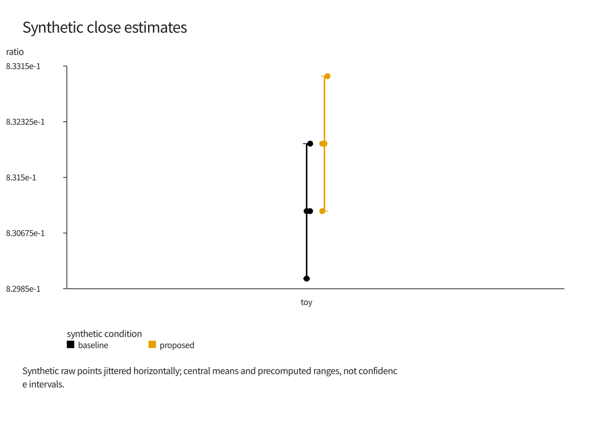
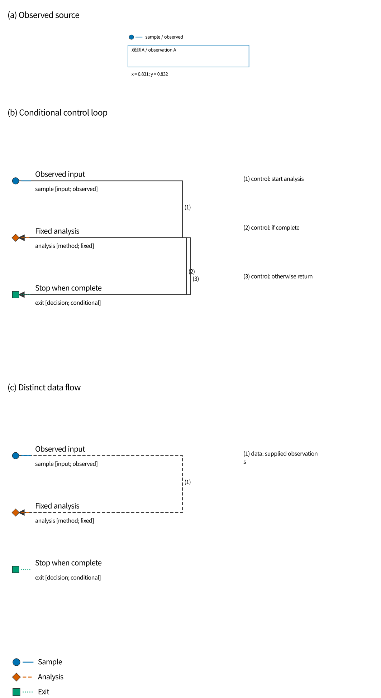
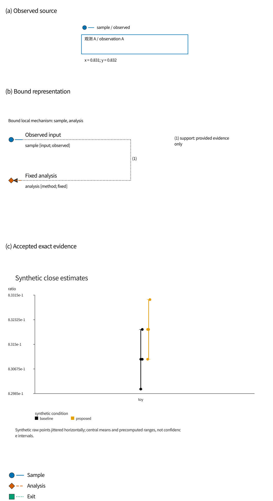
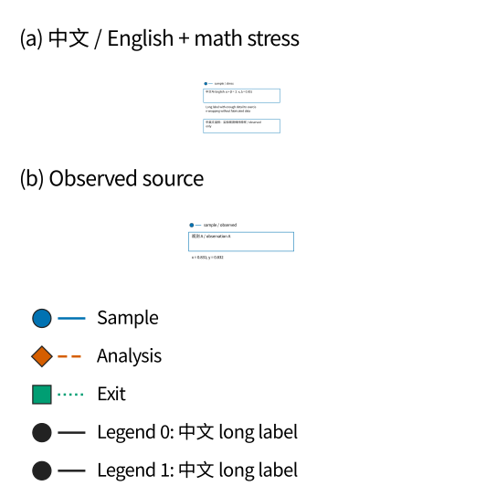

# 公开制图基准：待独立人工审阅

这里的“接受”只表示你能从指定图片读懂该 toy 图，不认可任何真实科研结论。生成程序没有替你填写判定。
请按 PNG 在声明的毫米尺寸查看；过小或看不清就选“修改”，不需要理解源码。示例尺寸是作者定义的测试 profile，不声称符合某期刊版式。

## exact

[查看同一输出的灰阶版本](exact-single/figure-gray.png)

SVG/PDF/IR：`exact-single/`。目标 180.0 × 130.0 mm，最小字高 7.02 pt。

1. 能否分清 baseline 和 proposed？转灰阶后还能分清吗？
2. 是否能同时看到原始点、均值和区间？这里区间是合成数据的预计算范围，不是置信区间。
3. 请选择：接受 / 修改 / 拒绝，并用一句话写明理由。

## loop

[查看同一输出的灰阶版本](loop-column/figure-gray.png)

SVG/PDF/IR：`loop-column/`。目标 180.0 × 330.0 mm，最小字高 6.17 pt。

1. 能否找到输入、analysis 和条件出口？看不清的文字或箭头请指出位置。
2. 能否看出 complete 时退出、otherwise 时返回 analysis？控制关系与数据关系能否区分？
3. 请选择：接受 / 修改 / 拒绝，并用一句话写明理由。

三种结构候选（科学事实相同，尚待你确认结构差异与选择）：
- [row](loop-row/figure.png)
- [column](loop-column/figure.png)
- [grid](loop-grid/figure.png)
预选 column：保留全宽对象与结果，减少横排缩小字体。row/grid 的小字和路径密度保留在报告中。

## mixed

[查看同一输出的灰阶版本](mixed-column/figure-gray.png)

SVG/PDF/IR：`mixed-column/`。目标 180.0 × 330.0 mm，最小字高 6.74 pt。

1. 能否认出前后面板的 sample 是同一对象，而没有声称已证明因果变化？
2. 你能找到结果面板并读清 baseline/proposed 吗？对象和证据的联系是否清楚？
3. 请选择：接受 / 修改 / 拒绝，并用一句话写明理由。

三种结构候选（科学事实相同，尚待你确认结构差异与选择）：
- [row](mixed-row/figure.png)
- [column](mixed-column/figure.png)
- [grid](mixed-grid/figure.png)
预选 column：保留全宽对象与结果，减少横排缩小字体。row/grid 的小字和路径密度保留在报告中。

## stress

[查看同一输出的灰阶版本](stress-single/figure-gray.png)

SVG/PDF/IR：`stress-single/`。目标 90.0 × 90.0 mm，最小字高 1.53 pt。

1. 中文、英文和数学符号是否缺字、重叠或被裁切？
2. 长标签和图例是否还能读懂？这是压力测试，发现缺陷是有效结果。
3. 请选择：接受 / 修改 / 拒绝，并用一句话写明理由。

## 边界

这份表还没有任何真实人工签字。机械检查、制图者自查和接受回执均不能替代你的审阅。任何 IR、SVG、PNG、字体或环境变化都使旧绑定失效。受信研究运行如需出版接受，仍须由父级按现有 arw.visual-review.v1 契约独立接纳审查证据。
